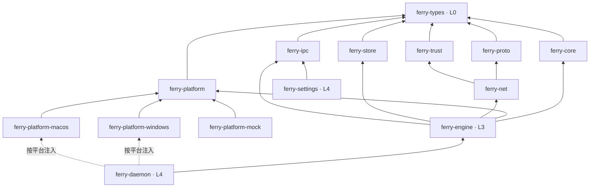

# 架构总览

工程规则（分层、依赖、命名、测试）以 [AGENTS.md](../AGENTS.md) 为准，本文只描述系统如何运作。

## 进程

| 进程 | 可执行文件 | 生命周期 | 职责 |
|---|---|---|---|
| 后台 | `screenferry` | 常驻 | 键鼠捕获与注入、网络、同步、托盘 |
| 设置界面 | `screenferry-settings` | 按需启动，关闭即退出 | 设备布局、设置、剪贴板历史 |

两者通过本机 IPC 通信。配置只由后台写入。

## 网络连接

每对设备之间建立两条 TCP + TLS 1.3 连接，使用同一套设备证书双向认证：

| 连接 | 内容 | 要求 |
|---|---|---|
| 输入连接 | 键鼠事件、心跳、屏幕切换、控制命令 | 低延迟，`TCP_NODELAY`，不能被大数据堵塞 |
| 数据连接 | 剪贴板、图片、文件 | 分块传输，限速、限大小、可取消 |

## crate 依赖

`ferry-engine` 只认识 `ferry-platform` 的 trait；`ferry-daemon` 在编译时按目标平台选择实现并注入。场景测试中用 `ferry-platform-mock` 替代真实平台。
